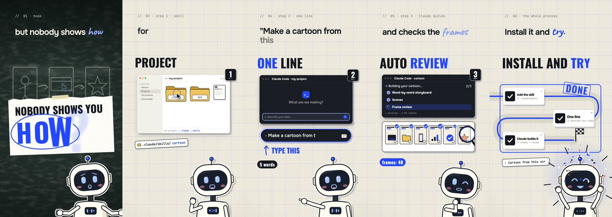
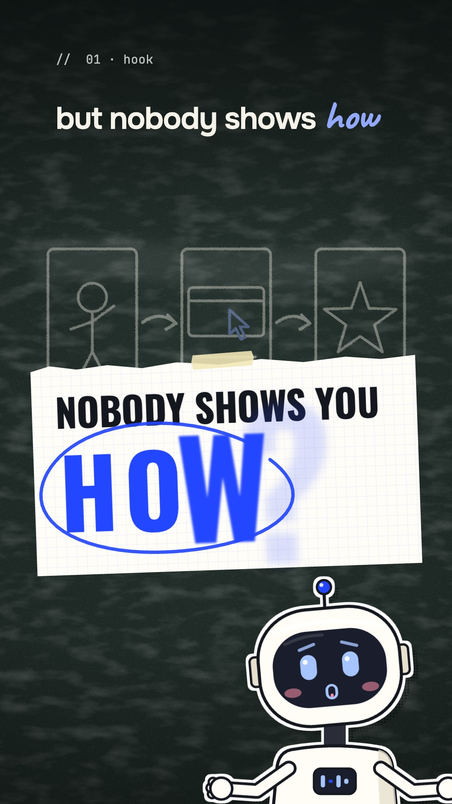
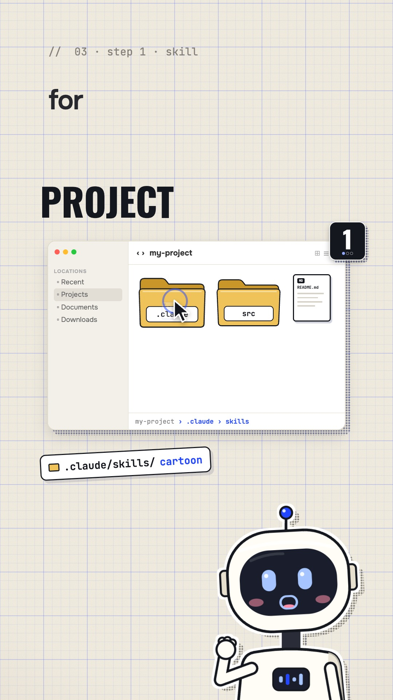
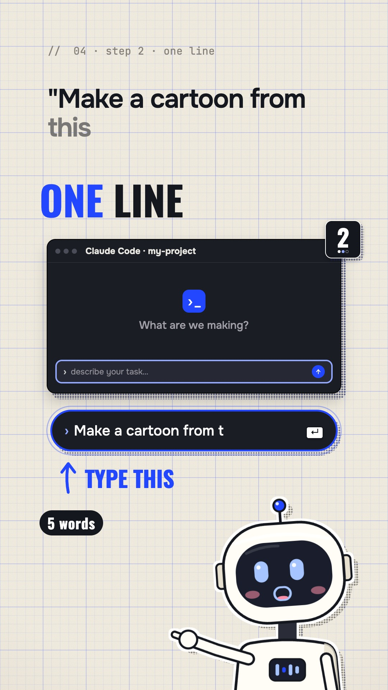
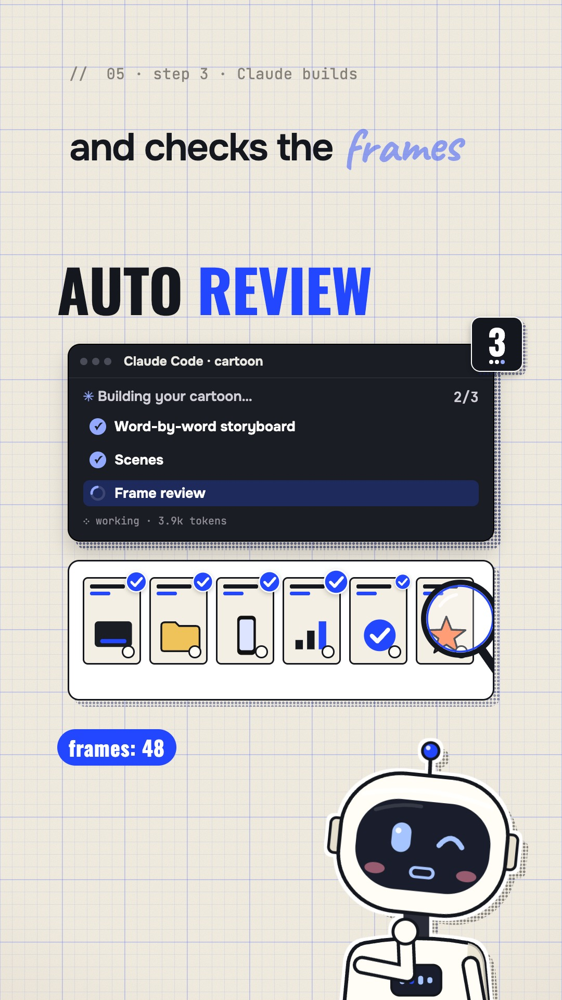
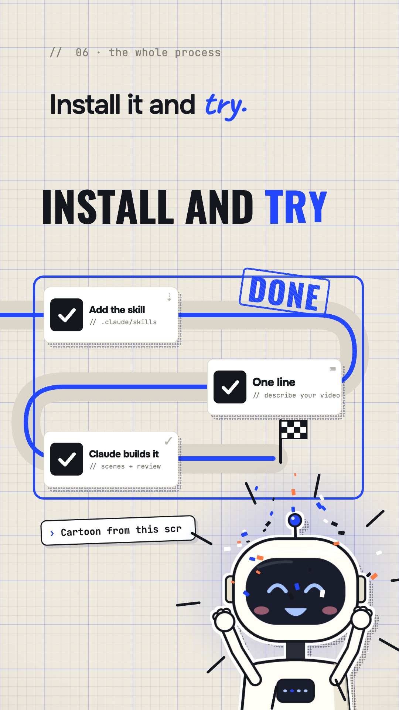
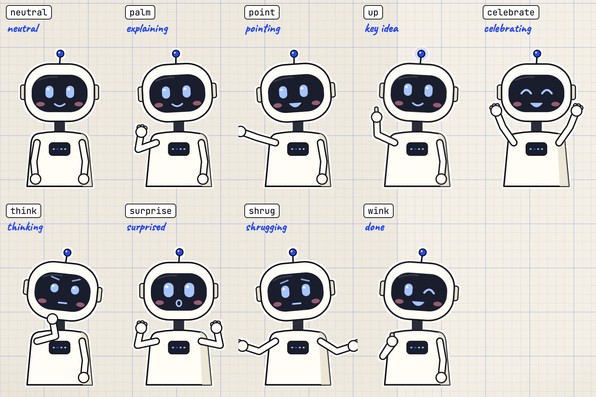

# Cartoon Skill

Say **“Cartoon”** in [Claude Code](https://code.claude.com/docs/en/overview) and turn an idea into a vertical animated explainer, with your own character, visual style, and voice. Use Viralex AI to find ideas gaining traction in your niche, then build scenes in code: windows open, the cursor clicks, words trigger actions, and a sticker character stays with you throughout.



▶ [Watch the English demo with event sounds](docs/demo.mp4)

Scenes, interfaces, captions, and transitions use [Remotion](https://www.remotion.dev). Text stays editable and revisions are code changes. No stock footage is needed. You can generate a character sheet from your own photo once, then animate it in code.

## A look inside

| The hook | Create a folder | Give it a prompt | Watch it build | The result |
|---|---|---|---|---|
|  |  |  |  |  |

Meet **Beep**, the built-in vector robot: nine poses, blinking eyes, a voice-driven mouth, and a chest equalizer. A custom character uses the same nine poses in a three-by-three atlas.



## Install

Run this in your project folder:

```bash
npx -y degit artemiimillier/cartoon-skill/.claude/skills/cartoon .claude/skills/cartoon
```

Or download the whole repository, including the demo:

```bash
npx -y degit artemiimillier/cartoon-skill
```

For every project, place the `cartoon` skill folder in `~/.claude/skills/`. On first use, Claude creates a working studio at `cartoon/` in your project and walks you through setup. The installed skill stays untouched.

## First run

Open Claude Code in the project and say **“Cartoon.”** Progress is saved in `cartoon/setup.json`, so you can stop and resume.

1. **Connect Viralex AI MCP.** This is required before anything else. Viralex AI supplies niche trends and reference-video analysis. Visit [viralex.ai](https://viralex.ai), then connect `https://mcp.viralex.ai/mcp` using either route:
   - **claude.ai → Settings → Connectors → Add custom connector**, enter the URL and authenticate.
   - Run `claude mcp add --transport http viralex https://mcp.viralex.ai/mcp`, then open `/mcp` in Claude Code and authenticate. Add `--scope user` if you want the connection across projects.
   Restart or refresh the session. Claude must verify the connection with the free `account` tool. If the server does not expose that tool or the call fails, setup stays at this step. No gift credits are promised.
2. **Choose your niche.** Share your Instagram or TikTok profile, or describe what you make. Claude helps choose the relevant niches.
3. **Choose a visual style.** Share a reference video or use the built-in cobalt-on-graph-paper look. The skill studies layout and motion without copying the creator's footage, identity, or claims.
4. **Choose a character.** Use your own photo to make a pose sheet in ChatGPT or Gemini, use an image API, or keep Beep.
5. **Choose a voice.** Record each script yourself or use an ElevenLabs voice clone you have permission to use.
6. **Check the environment.** Claude checks Node, npm, Python, and ffmpeg, then installs the studio dependencies.
7. **Optional: connect your Telegram bot.** Receive finished files privately. You publish them yourself.

Then try:

- **“Cartoon”** — find promising references from the past forty-eight hours in your niche.
- **“Cartoon from this link…”** — use a specific reference.
- **“Cartoon about…”** — start with your own topic.

Claude shows the full script for approval before narration. Then it creates the voice track, maps actions to words, builds scenes, reviews frames, and exports the MP4 with a suggested description. Service charges are shown before paid calls.

## Try the bundled demo

The demo has synthetic timing and event sounds, with no generated narration. It is a rendering example; producing a new video through the skill still requires the MCP setup gate.

```bash
cd .claude/skills/cartoon/kit
npm i
npx remotion studio src/index.ts
python3 scripts/sfx.py examples/demo/props.json examples/demo/sfx.json -o public/demo-sfx.wav
npx remotion render src/index.ts Demo out/demo.mp4
```

## What's included

```text
.claude/skills/cartoon/
├── SKILL.md             Setup, trends, script approval, production, delivery
├── method.md            Word-driven storyboard and animation workflow
└── kit/
    ├── setup.example.json
    ├── style/STYLE.md   Built-in visual system; template for your own
    ├── src/theme.ts     Palette, fonts, layout
    ├── src/lib/         Motion, interfaces, marks, props
    ├── src/hero/        Beep, atlas rig, character selection, pose sheet
    ├── src/Film.tsx     Background, captions, character, transitions, audio
    ├── examples/demo/  English captions, cues, scenes, synthetic timing
    └── scripts/        Setup, character, voice, timing, QA, private delivery
```

## Requirements

- Claude Code and an authenticated Viralex AI MCP connection.
- Node.js 18+ and npm. Remotion downloads its headless browser.
- Python 3.9+; the helper scripts use the standard library unless noted.
- ffmpeg and ffprobe for audio, frame sheets, and Telegram compression.
- Optional: `pip install faster-whisper` for local word timing, and `pip install pillow` for faster atlas processing and comparison sheets.
- An internet connection for Google Fonts during rendering.

Keep optional API keys in `cartoon/.env`: `OPENAI_API_KEY` or `GEMINI_API_KEY` for a custom character, `ELEVENLABS_API_KEY` for voice synthesis, and `TELEGRAM_BOT_TOKEN` for your own bot. Both `.env` and `setup.json` are ignored by Git. Photos are sent only to the image provider you select.

## Make it yours

- **Style:** edit `cartoon/style/STYLE.md` and `src/theme.ts`. Changing `T.accent` updates rings, stamps, and highlighted words.
- **Fonts:** replace the imports from `@remotion/google-fonts` in `theme.ts`.
- **Character:** `src/hero/current.ts` selects Beep or your own atlas. `scripts/atlas_rig.py --install` connects an atlas; inspect the rig before rendering.

## License

The code is MIT licensed; see [LICENSE](LICENSE). Remotion has its [own license](https://www.remotion.dev/license). Check its current terms for your use. Bundled font families use the SIL Open Font License.

---

**By Arti Miller**

[Instagram](https://instagram.com/arti.miller) · [TikTok](https://tiktok.com/@viralex.aii) · [YouTube](https://youtube.com/@Arti.miller)
